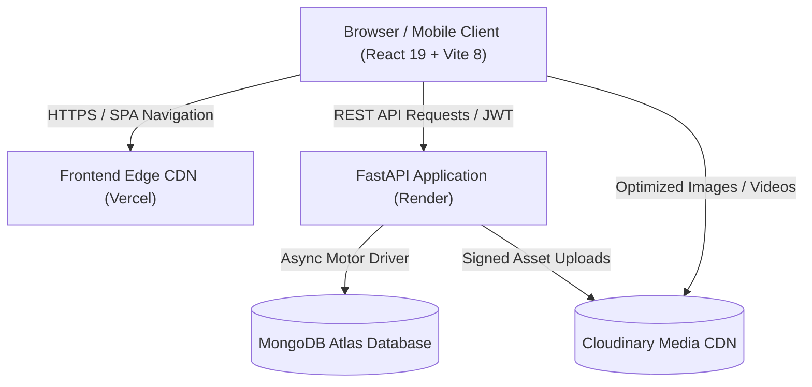

# KHILATKARI (خلعت کاری) — Heritage in Every Stitch

[](frontend/)
[](backend/)
[](backend/)
[](https://cloudinary.com)
[](frontend/)
[](LICENSE)

A modern full-stack web application and content management platform engineered for **KHILATKARI** — an appointment-based luxury South Asian couture label specializing in handcrafted Kamdani, Mukesh, Gota, fine thread embroidery, and bespoke bridal wear.

The platform provides a responsive customer storefront with seamless WhatsApp concierge integration and a management portal for inventory, appointments, and homepage visual positioning.

---

## 🌟 Key Application Features

### 1. Luxury Customer Storefront
- **Bilingual Branding & Typography:** Seamless integration of Urdu calligraphic Nastaliq (`خلعت کاری`) and English serif typography (`Playfair Display`) with bidirectional text isolation (`direction: rtl; unicode-bidi: isolate`).
- **Interactive Curated Lookbook:** High-performance catalog browsing with real-time category filtering (Chikankari, Kamdani, Gota & Mukesh, Bridal Wear), price formatting, and availability status tags.
- **Piece Detail & Deep Linking:** Editorial garment showcases with multiple photography angles, fabric specifications, availability indicators, and deep-linked appointment auto-fill.
- **Private In-Home Viewing Concierge:** Dedicated booking workflow for private resident consultations across **Lahore, Islamabad, Rawalpindi, and Peshawar**, with direct one-click WhatsApp concierge dispatch.
- **Mobile-First Responsive Engineering:** Collision-free mobile navigation, responsive touch-enabled hero carousel, uncropped emblem brand art, and horizontal scroll protection.

### 2. Administrative Management Portal
- **Dashboard Metrics:** Real-time summary of catalog inventory, active appointments, and recent booking inquiries.
- **Visuals & Homepage CMS:** Interactive focal-point calibration (X/Y coordinate positioning and zoom scale) for hero slides and visual galleries without redeploying code.
- **Inventory & Category Control:** Full CRUD operations for couture pieces, category display order, and instant homepage featured toggles.
- **Appointment Management:** Review consultation inquiries, filter by city or date, update booking lifecycle statuses (`Pending`, `Contacted`, `Confirmed`, `Completed`, `Cancelled`), and save internal concierge notes.

---

## 🏛️ System Architecture



---

## 🛠️ Technology Stack

| Layer | Technologies | Description |
| :--- | :--- | :--- |
| **Frontend** | React 19.2, Vite 8.3, TypeScript, React Router 7 | Modern Single Page Application with optimized bundle splitting and lazy-loaded routes |
| **Styling** | Tailwind CSS v4, Lucide React, Google Fonts | Responsive luxury design system with custom HSL tokens, Urdu typography, and micro-animations |
| **Backend** | Python 3.12+, FastAPI, Uvicorn, Pydantic v2 | High-throughput asynchronous REST API with automatic OpenAPI documentation |
| **Database** | MongoDB Atlas, Motor (Async), PyMongo | Document-based data model with compound indexing and connection pooling |
| **Media** | Cloudinary CDN | Cloud-based media storage with automatic WebP conversion and responsive delivery |
| **Security** | Python-Jose, Passlib (Bcrypt), Starlette Middleware | JWT authentication, salted password hashing, strict CORS, and secret scrubbing |

---

## 🛡️ Security & Defensive Engineering

- **CORS Protection:** Cross-Origin Resource Sharing is strictly locked to approved production origins and verified preview regex patterns. Wildcard credentials access is disallowed.
- **Authentication & Token Lifecycle:** Admin endpoints are secured by HS256-signed JWTs with configurable expiration (`ACCESS_TOKEN_EXPIRE_MINUTES`). Passwords use salted Bcrypt hashing.
- **Zero Secret Leakage in Logs:** Custom `SecretScrubbingFilter` and `sanitize_log_message` redact sensitive parameters (passwords, tokens, database URIs, API keys) from standard output.
- **Upload Hardening:** Uploaded files undergo MIME type verification and magic-byte signature validation (genuine JPEG SOI / PNG headers) to prevent polyglot file uploads.
- **URL Sanitization:** Media URLs are validated against strict protocols (`https://`) and authorized CDN hostnames (Cloudinary), blocking SSRF vectors.
- **Generic Error Responses:** Centralized exception handlers catch internal 500 errors and return sanitized generic messages to clients, preventing stack trace disclosure.

---

## ⚡ Quick Start (Local Development)

### Prerequisites
- Node.js 18+ & npm
- Python 3.12+
- MongoDB instance (Local or MongoDB Atlas free tier)

### 1. Backend Setup

```bash
cd backend

# Create and activate virtual environment
python -m venv venv
# Windows:
venv\Scripts\activate
# Linux/macOS:
source venv/bin/activate

# Install dependencies
pip install -r requirements.txt

# Configure environment variables
cp .env.example .env
# Edit .env with your local MONGODB_URI and a test SECRET_KEY

# Seed database with initial admin user and baseline catalog
python seed.py

# Start FastAPI development server (port 8000)
uvicorn app.main:app --host 127.0.0.1 --port 8000 --reload
```

Interactive API documentation will be available at `http://127.0.0.1:8000/docs`.

### 2. Frontend Setup

```bash
cd frontend

# Install dependencies
npm install

# Configure environment variables
cp .env.example .env
# Optional: set VITE_API_URL=http://localhost:8000 (defaults to local proxy)

# Run linter and type-checker
npm run lint
npm run build

# Start Vite dev server (port 5173)
npm run dev
```

Visit the storefront at `http://localhost:5173`.
Management portal: `http://localhost:5173/admin/login`.

---

## 🧪 Testing & Quality Assurance

```bash
# Frontend: Run linting and production build verification
cd frontend
npm run lint
npm run build

# Backend: Run automated pytest test suite
cd backend
pytest tests
```

---

## 📂 Repository Structure

```
khilatkari/
├── frontend/                     # React 19 + TypeScript + Vite 8 frontend
│   ├── src/
│   │   ├── components/           # Reusable UI, layout & product cards
│   │   ├── layouts/              # PublicLayout & AdminLayout
│   │   ├── pages/                # Storefront pages & Admin management pages
│   │   ├── services/             # Axios API services (products, appointments, auth, cms)
│   │   ├── data/                 # Brand constants, fallback models, city definitions
│   │   └── utils/                # Media URL resolvers, currency formatters
│   ├── public/                   # Favicons, webmanifest, emblem logos, robots.txt, sitemap.xml
│   ├── package.json
│   └── vite.config.ts
├── backend/                      # FastAPI Python backend
│   ├── app/
│   │   ├── main.py               # Application factory, middleware & router inclusion
│   │   ├── config.py             # Pydantic BaseSettings configuration
│   │   ├── database.py           # MongoDB connection & index generation
│   │   ├── routes/               # Public and /api/admin endpoints
│   │   ├── schemas/              # Pydantic request/response schemas
│   │   ├── services/             # Business logic layer
│   │   └── utils/                # Security, rate-limiting, and log sanitization
│   ├── tests/                    # Pytest test suite
│   ├── seed.py                   # Catalog and admin account seeder
│   └── requirements.txt
├── .env.example                  # Safe placeholder environment configuration
├── .gitignore                    # Git ignore rules for node, python, secrets, uploads
├── LICENSE                       # Proprietary portfolio license
├── README.md                     # Project documentation
└── SECURITY.md                   # Responsible disclosure policy
```

---

## 📄 License & Intellectual Property

This project and its original branding assets ("KHILATKARI", "خلعت کاری", "Heritage in Every Stitch") are protected under the [Proprietary Portfolio License](LICENSE). You are welcome to inspect and review the source code for technical evaluation and portfolio demonstration.
